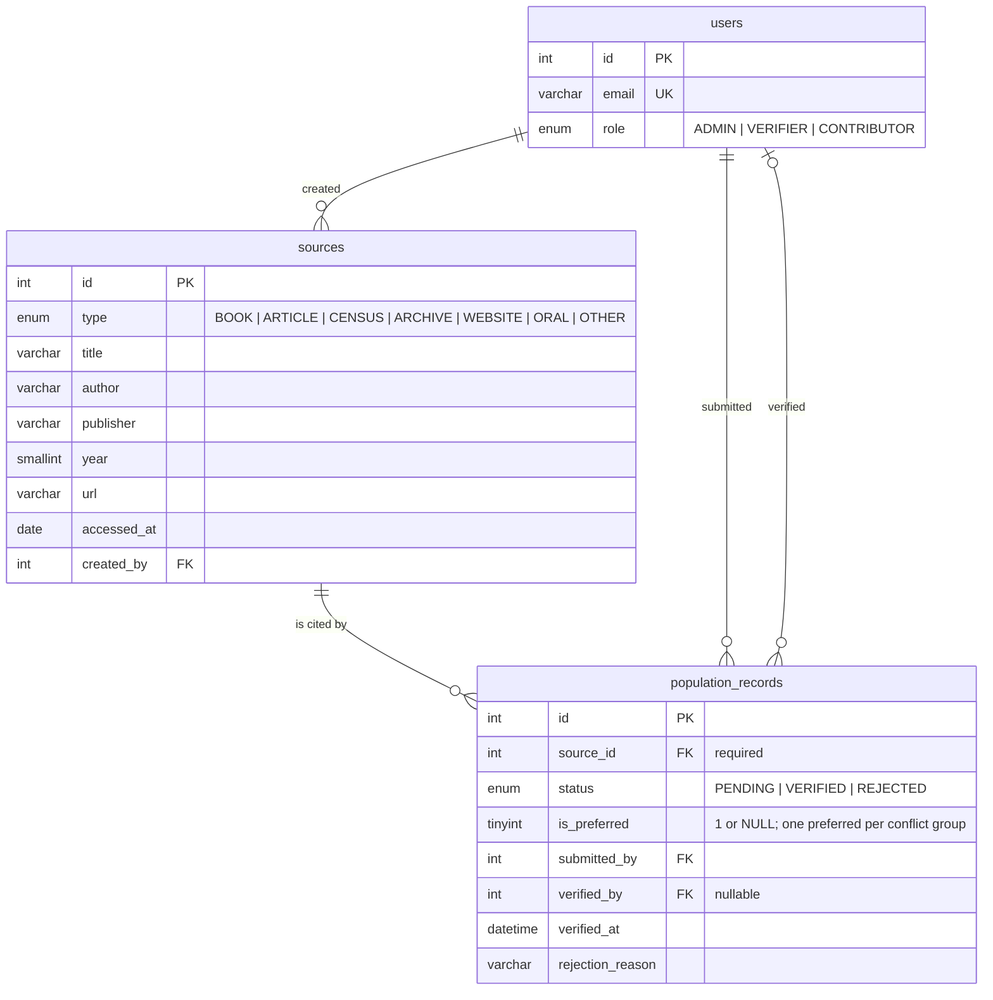
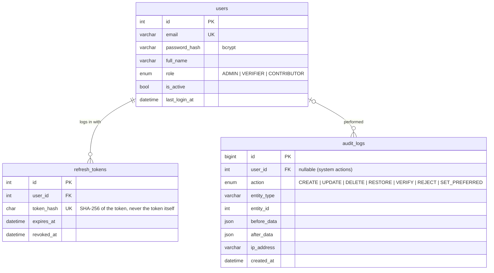

# Entity-Relationship Diagram

This is the logical data model of the Qaryati API (MySQL 8, InnoDB, `utf8mb4_0900_ai_ci`).
Column-level detail, constraints and indexes are in the [data dictionary](data-dictionary.md).
The provenance, verification and conflict rules are explained in
[ADR-0005](../adr/0005-data-provenance-and-verification.md).

The model is split into three diagrams so each one stays readable:

1. **Villages and their facts**: what we know about a village.
2. **Provenance**: where each fact came from and who added or checked it.
3. **Accounts and audit**: users, login tokens and the change history.

---

## 1. Villages and their facts

```mermaid
erDiagram
  governorates ||--o{ municipalities : contains
  governorates ||--o{ villages : administers
  municipalities |o--o{ villages : "serves (optional)"

  villages ||--o{ village_names : "is known as"
  villages ||--o{ population_records : "has census data"
  villages ||--o{ event_villages : "is affected by"
  historical_events ||--o{ event_villages : "affects"
  villages ||--o{ landmarks : has
  villages ||--o{ cultural_traits : has
  villages ||--o{ economic_activities : has
  villages ||--o{ facilities : has
  villages ||--o{ village_relations : "is subject of"
  villages ||--o{ village_relations : "is related village in"

  governorates {
    int id PK
    varchar name_ar UK
    varchar name_en UK
  }
  municipalities {
    int id PK
    int governorate_id FK
    varchar name_ar
    varchar name_en
    enum type "MUNICIPALITY | VILLAGE_COUNCIL | JOINT_COUNCIL"
  }
  villages {
    int id PK
    varchar name_ar "current official name (denormalised for list/sort)"
    varchar name_en
    text name_origin
    int governorate_id FK
    int municipality_id FK "nullable"
    decimal latitude "required, CHECK -90..90"
    decimal longitude "required, CHECK -180..180, INDEX (latitude, longitude)"
    text location_description
    int elevation_m
    decimal area_dunum
    datetime deleted_at "soft delete (hidden, restorable)"
  }
  village_names {
    int id PK
    int village_id FK
    varchar name "FULLTEXT"
    enum language "AR | EN | OTHER"
    enum type "CURRENT | ENGLISH | HISTORICAL | TRANSLITERATION | ALTERNATIVE"
    varchar period_note
    int source_id FK
  }
  population_records {
    int id PK
    int village_id FK
    smallint year
    int population
    int households
    int source_id FK "required"
    text notes
  }
  historical_events {
    int id PK
    varchar title
    text description
    enum category "POLITICAL | SOCIAL | ECONOMIC | CULTURAL | NATURAL | OTHER"
    smallint year_from
    smallint year_to
    enum date_precision "EXACT | YEAR | DECADE | APPROXIMATE"
    int source_id FK "required"
  }
  event_villages {
    int event_id PK, FK
    int village_id PK, FK
    varchar note
  }
  landmarks {
    int id PK
    int village_id FK
    varchar name_ar
    varchar name_en
    enum type "MOSQUE | CHURCH | SHRINE | SPRING | ARCHAEOLOGICAL_SITE | OLD_BUILDING | NATURAL | OTHER"
    text description
    decimal latitude "optional"
    decimal longitude "optional"
    varchar period
    enum current_condition "GOOD | DAMAGED | DESTROYED | UNKNOWN"
    int source_id FK "required"
  }
  cultural_traits {
    int id PK
    int village_id FK
    enum category "FOOD | CRAFT | DRESS | MUSIC_DANCE | FESTIVAL | DIALECT | CUSTOM | OTHER"
    varchar title
    text description
    int source_id FK "required"
  }
  economic_activities {
    int id PK
    int village_id FK
    enum type "AGRICULTURE | LIVESTOCK | TRADE | CRAFT | INDUSTRY | TOURISM | SERVICES | OTHER"
    varchar name
    text description
    enum importance "MAIN | SECONDARY"
    smallint year_from
    smallint year_to
    int source_id FK "required"
  }
  facilities {
    int id PK
    int village_id FK
    enum type "SCHOOL | CLINIC | HOSPITAL | POST_OFFICE | WATER_NETWORK | ELECTRICITY | COMMUNITY_CENTER | OTHER"
    varchar name
    enum status "ACTIVE | CLOSED | PLANNED"
    smallint year_established
    decimal latitude "optional"
    decimal longitude "optional"
    int source_id FK "required"
  }
  village_relations {
    int id PK
    int village_id FK
    int related_village_id FK
    enum type "SPLIT_FROM | MERGED_WITH | FORMERLY_PART_OF | OTHER"
    smallint year
    int source_id FK "required"
  }
```

"Nearby villages" is **not** stored as a table. It is computed on request: a bounding box on the
`(latitude, longitude)` index narrows the candidates, then `ST_Distance_Sphere` gives the exact
distance (see [ADR-0006](../adr/0006-nearby-villages-from-coordinates.md)). Distances can never go stale.

---

## 2. Provenance (sources and verification)

Every **fact table** (`village_names`, `population_records`, `historical_events`, `landmarks`,
`cultural_traits`, `economic_activities`, `facilities`, `village_relations`) carries the same
provenance block. `population_records` is shown as the example. The other fact tables have
identical links to `sources` and `users`.

---

## 3. Accounts and audit

`audit_logs` is append-only: the application never updates or deletes rows in it.

---

## Where native SQL is used

Prisma handles normal CRUD. These parts of the model are only reached through `$queryRaw`
or custom migration SQL (see ADR-0003):

| Feature | Table / column | Why Prisma alone is not enough |
|---|---|---|
| Nearby villages | bounding box on `(latitude, longitude)` + `ST_Distance_Sphere(POINT(longitude, latitude), POINT(?, ?))` | spatial function, distance ordering (ADR-0006) |
| Name search ranking | `MATCH(village_names.name) AGAINST(?)` | relevance score and ordering (the `FULLTEXT` index itself is declared with `@@fulltext` in Prisma) |
| Data rules | `CHECK` constraints (coordinates, year ranges, self-relation, preferred flag) | Prisma cannot declare `CHECK` constraints, so they are added in the migration SQL |
| Population trends report | `population_records` grouped by year | aggregate reporting query |
| Only one preferred row per group | unique index on nullable `is_preferred` | relies on MySQL treating NULLs as distinct |
