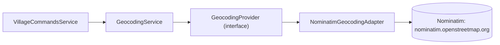

# Geocoding

A village needs coordinates ([ADR-0006](../adr/0006-nearby-villages-from-coordinates.md)).
If a contributor does not send `latitude` and `longitude` when creating a village, the API
looks them up with an external geocoding service. This page explains how that works, what
happens when it fails, and how to configure it.

## Where it is used

Only `POST /villages` (`VillageCommandsService.create`). If the request has both
`latitude` and `longitude`, geocoding is **not** called. Sending only one of them is a
`400`.

## How it works

| Part | File | Job |
|---|---|---|
| `VillageCommandsService` | `src/villages/village-commands.service.ts` | Builds the query, checks the result, decides the error (422 or 503) |
| `GeocodingService` | `src/geocoding/geocoding.service.ts` | Thin service that the rest of the app injects. It only calls the provider |
| `GeocodingProvider` | `src/geocoding/interfaces/geocoding-provider.interface.ts` | `geocode(placeName)` returns `{ latitude, longitude, displayName }` or `null` |
| `NominatimGeocodingAdapter` | `src/geocoding/adapters/nominatim-geocoding.adapter.ts` | Talks to Nominatim: cache, rate limit, timeout, retry |

The rest of the app never talks to Nominatim directly (ADR-0004, rule 6). To change the
provider, write another class that implements `GeocodingProvider` and provide it in
`geocoding.module.ts`. Nothing else changes.

### The query

The query is built from the English names: `"<nameEn>, <governorate nameEn>, Palestine"`,
for example `Kafr Zaytoun, Nablus, Palestine`. The adapter asks Nominatim for
`/search?q=...&format=jsonv2&limit=1`, so it uses only the first result.

### Rules inside the adapter

| Rule | Value |
|---|---|
| Cache | In memory, one entry per query (trimmed, lower case). Found places **and** "not found" are cached. Errors are never cached. It is emptied when the API restarts |
| Rate limit | At most 1 request per second to Nominatim (the gap is 1.1 s). Requests wait in a queue, one after the other. Every retry also goes through this wait |
| Timeout | 3 seconds for each try (`GEOCODING_TIMEOUT_MS`) |
| User-Agent | Required. Nominatim's usage policy asks for an identifying `User-Agent` |
| Empty name | A blank place name returns `null` without calling Nominatim |
| Coordinates check | A latitude/longitude that is not a number or out of range throws an error |

### Retry rules

Temporary problems are tried again, up to **2 more times** (3 tries in total). The adapter
waits **500 ms** before the 2nd try and **1 s** before the 3rd.

| What happened | Retry? |
|---|---|
| Timeout (no answer in 3 s) | Yes |
| Network error (`fetch` fails, for example no connection) | Yes |
| HTTP 429 (too many requests) | Yes |
| HTTP 5xx (Nominatim has a problem) | Yes |
| Other 4xx, for example 400 | No: the request is wrong, a retry gives the same answer |
| Place not found (empty answer) | No: Nominatim answered, there is just no match. The `null` is cached |
| Invalid coordinates in the answer | No |

If all 3 tries fail, the last error is thrown to `VillageCommandsService`.

## What the API answers

`VillageCommandsService` checks the result before it accepts it:

| Situation | Answer | Message (short) |
|---|---|---|
| Found, inside the Palestine box | village is created | |
| Nominatim found nothing (`null`) | **422** | `Could not find coordinates for "...". Please send latitude and longitude.` |
| Found, but outside the box (lat 29.4–33.4, lng 34.2–35.9) | **422** | same message: it is probably another place with the same name |
| The adapter threw an error (still failing after the retries) | **503** | `The geocoding service is not available right now. Please send latitude and longitude.` |

Good to know when the service is down:

- **The village is not created.** The lookup runs *before* the database transaction, so
  nothing is written: no village row, no names, no audit row.
- The error is written to the server log as a warning (`Geocoding failed for "...": ...`).
- **The user can still add the village:** send `latitude` and `longitude` in the request.
  Then geocoding is skipped completely, so a Nominatim outage never blocks contributors
  who know the coordinates.
- The user can also try again later. Retries inside one request only cover short problems
  (about 1.5 s of waiting in total); they do not replace trying again after a few minutes.

Time for one request in the worst case: 3 tries x 3 s timeout + 1.5 s of retry waits +
the 1 s rate-limit waits, so up to about 12 seconds before the `503` arrives.

## Settings (`.env`)

Read in `src/geocoding/geocoding.module.ts` when the app starts.

| Variable | Default | Meaning |
|---|---|---|
| `GEOCODING_USER_AGENT` | none, **required** | Sent as `User-Agent` to Nominatim. Use your app name and a real contact, for example `Qaryati/1.0 (contact: you@example.com)`. If it is empty, **the API does not start** (`GEOCODING_USER_AGENT must be configured`) |
| `GEOCODING_BASE_URL` | `https://nominatim.openstreetmap.org` | Address of the Nominatim server. Empty means the default. Use it to point to your own Nominatim instance or to a fake server in tests |
| `GEOCODING_TIMEOUT_MS` | `3000` | Time to wait for one try, in milliseconds |
| `GEOCODING_API_KEY` | not used | It is in `.env.example`, but the code does not read it. The public Nominatim needs no key. It is reserved for a provider that needs one |

The retry waits (500 ms, 1 s) and the 1.1 s gap are not settings: they are constants in the
adapter. (The adapter accepts them as constructor options, which the unit tests use.)

## Limits to keep in mind

- The **rate limit and the cache are per API process**. If we run several instances, each
  one sends up to 1 request per second, so together they can go over Nominatim's limit.
  A shared cache or queue (for example Redis) would be needed then.
- The public Nominatim server is for light use. If we geocode many villages (imports), use
  our own Nominatim server (`GEOCODING_BASE_URL`) or send the coordinates in the data.
- The first result is used without comparing it with the Arabic name. The Palestine box
  catches places in other countries, not a wrong village inside Palestine. Contributors
  can always correct the coordinates later.

## Tests

- `nominatim-geocoding.adapter.spec.ts`: adapter with a fake `fetch`: cache, empty name,
  timeout, invalid coordinates and the retry rules.
- `geocoding.service.spec.ts`: the service calls the provider; the module resolves in Nest.
- `village-commands.service.spec.ts`: geocoding is skipped when coordinates are sent, and
  the 422 and 503 answers.
