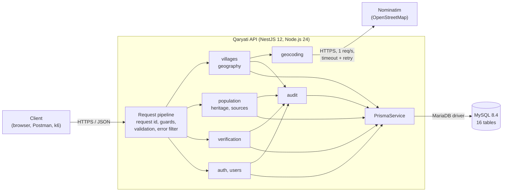
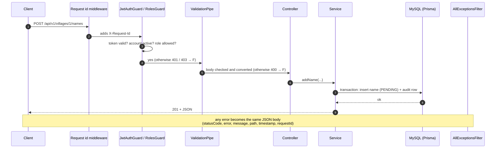
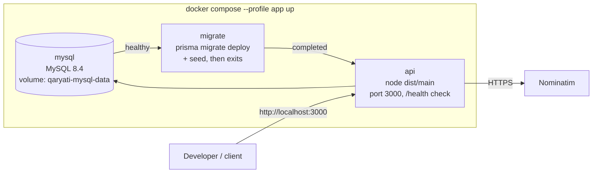

# Architecture overview

Qaryati is a **modular monolith** (ADR-0004): one NestJS application, split into feature
modules that share one MySQL database through Prisma. There is no frontend; clients use the
REST API under `/api/v1` (documented with Swagger at `/api/docs`).

## 1. Components

| Module | Responsibility | Main endpoints | Owner |
|---|---|---|---|
| `villages` | villages (create, update, hide, restore), full-text name search, names and relations | `/villages`, `/villages/:id/names`, `/villages/:id/relations` | Shahd |
| `geography` | governorates, municipalities, nearby villages (ADR-0006) | `/governorates`, `/villages/:id/nearby` | Shahd |
| `auth` | register, login, refresh, logout, JWT and role guards, login rate limit | `/auth/*` | Batool |
| `users` | own profile, list users, change role, disable | `/users/*` | Batool |
| `audit` | audit log, written in the same transaction as each change | `/audit-logs` | Batool |
| `sources` | sources that facts refer to | `/sources` | Dana |
| `verification` | review queue, verify / reject / prefer for every kind of fact (ADR-0005, ADR-0007) | `/verification/*` | Dana |
| `population` | population records, conflicts, trends report (ADR-0008) | `/villages/:id/population`, `/reports/population-trends` | Dana |
| `heritage` | landmarks, historical events, cultural traits, economic activities, facilities | `/villages/:id/landmarks`, ... | Jana |
| `geocoding` | finds coordinates for a village name through Nominatim | (used by `villages`) | Jana |
| `prisma`, `health`, `common` | database access, `/health`, error filter, request ids, pagination, Swagger helpers | `/health` | Shahd |

Rules between modules:
- Every module talks to the database only through the global `PrismaService`.
- Writes go through `AuditService`, in the same transaction as the change.
- All facts are reviewed through one `VerificationService` (a registry of fact types), so the
  four-eyes rule and the status rules are the same for every module.
- Only `geocoding` calls an external service, behind the `GeocodingProvider` interface, so
  tests use a fake provider.

## 2. One request, step by step

Set up in `src/app.setup.ts` (used by `main.ts` **and** the e2e tests, so both behave the
same): global prefix `/api/v1` (except `/health`), the request id middleware, the global
`ValidationPipe` (`whitelist`, `forbidNonWhitelisted`, `transform`) and the global
`AllExceptionsFilter`. Details: [error model](error-model.md),
[security](../security.md), [auth](auth-authorization-audit.md).

## 3. Data

16 tables, created by Prisma migrations (`prisma/migrations/`). The full model is in the
[ERD](erd.md) and the [data dictionary](data-dictionary.md). The main ideas:

- **Provenance:** every fact (name, population figure, landmark, ...) has a `source`, a
  `status` (PENDING / VERIFIED / REJECTED), who submitted and who verified it
  ([provenance](provenance.md)).
- **Soft delete:** villages are hidden (`deleted_at`), not deleted, and hidden villages
  disappear from every public endpoint.
- **Native SQL where Prisma is not enough:** full-text search (`MATCH ... AGAINST`), nearby
  villages (`ST_Distance_Sphere` with a bounding box), the population trends report
  (`ROW_NUMBER`) and the review queue (`UNION ALL`). Always with query parameters.

## 4. Running it

- **Local development:** `docker compose up -d` starts only MySQL; the API runs with
  `npm run start:dev`.
- **Everything in Docker:** `docker compose --profile app up --build` (see
  [deployment](../deployment.md)).
- **CI (GitHub Actions):** lint, build, unit tests, then migrations + seed + e2e tests on a
  real MySQL 8.4, and a second job that builds the images and starts the whole stack.
  `main` is protected: pull request, green checks and one approval are required.

## 5. Quality and performance

- Unit tests per service and DTO, e2e tests against a real database (`test/`).
- k6 load tests in `perf/` (villages, login, population write and review, heritage), with
  the same load and targets for all: p95 < 500 ms, < 1% errors.
- One measured optimization: [faster village list](../performance/village-list-index.md).

## 6. Decisions

The important choices and why we made them are in the [ADRs](../adr/): NestJS (0002),
MySQL with Prisma (0003), modular monolith (0004), provenance and verification (0005),
nearby villages from coordinates (0006), verification rules (0007), population rules (0008).
