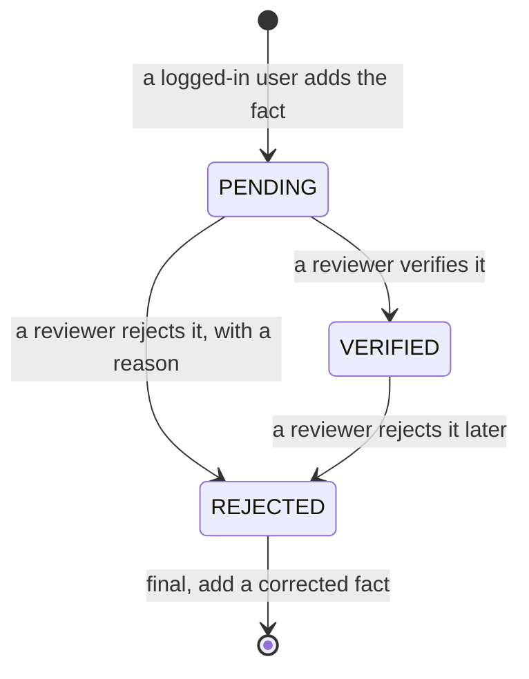
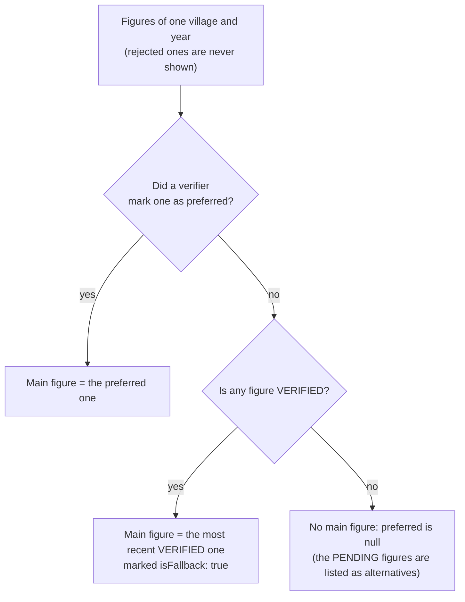

# Provenance: how a fact becomes trusted

Qaryati collects historical, demographic and geographic information from different
references, and these references often disagree. So the API never treats a new piece of
information as true just because someone typed it. Every **fact** goes through a review, keeps
the **source** it came from, and every change is written to the audit log.

This page explains the rules. The decisions behind them are in
[ADR-0005](../adr/0005-data-provenance-and-verification.md) (the model),
[ADR-0007](../adr/0007-verification-workflow-rules.md) (the review rules) and
[ADR-0008](../adr/0008-population-records-rules.md) (population figures).

## 1. What is a fact

A fact is one record that says something about a village and needs to be checked. There are
eight kinds. The **URL name** is the `{entityType}` of the verification endpoints.

| Fact | Table | URL name | Has a preferred value? |
|---|---|---|---|
| Village name | `village_names` | `village-names` | Yes, one per village, language and type |
| Population figure | `population_records` | `population-records` | Yes, one per village and year |
| Historical event | `historical_events` | `historical-events` | No |
| Landmark | `landmarks` | `landmarks` | No |
| Cultural trait | `cultural_traits` | `cultural-traits` | No |
| Economic activity | `economic_activities` | `economic-activities` | No |
| Facility | `facilities` | `facilities` | No |
| Village relation | `village_relations` | `village-relations` | No |

Every fact has the same review columns:

| Column | Meaning |
|---|---|
| `status` | `PENDING`, `VERIFIED` or `REJECTED`. In `facilities` this column is called `verification_status`, because `status` there is the operational status (ACTIVE, CLOSED, PLANNED) |
| `submitted_by` | The user who added the fact |
| `verified_by`, `verified_at` | The reviewer and the time of the last decision |
| `rejection_reason` | Why it was rejected (only for `REJECTED`) |
| `source_id` | The reference it comes from, in the `sources` table |
| `is_preferred` | Only in `village_names` and `population_records` |

A source is required for population figures, heritage facts (events, landmarks, traits,
activities, facilities) and village relations. A village name needs one only when its type is
`HISTORICAL`.

## 2. Life cycle of a fact



| Step | Who | Endpoint |
|---|---|---|
| Add | `CONTRIBUTOR`, `VERIFIER`, `ADMIN` | `POST` of the module, for example `POST /api/v1/villages/{id}/population` |
| Verify | `VERIFIER`, `ADMIN` (not the author) | `PATCH /api/v1/verification/{entityType}/{id}/verify` |
| Reject | `VERIFIER`, `ADMIN` (not the author) | `PATCH /api/v1/verification/{entityType}/{id}/reject` with `{ "reason": "..." }` |
| Prefer | `VERIFIER`, `ADMIN` | `PATCH /api/v1/verification/{entityType}/{id}/prefer` |

Rules that always apply:

- **A new fact is always `PENDING`**, even when a verifier or an admin adds it. The request
  cannot set `status`, `isPreferred` or the submitter (the API answers 400 if you try).
- **Only a `PENDING` fact can be verified.** Verifying twice gives 409.
- **A reject needs a reason** (up to 500 characters). A `PENDING` or a `VERIFIED` fact can be
  rejected, so a verified fact can be withdrawn later.
- **`REJECTED` is final.** It cannot be verified or rejected again (409). The contributor adds
  a new, corrected fact, so the history stays clear.
- **Facts are not edited in place.** There is no `PATCH` for facts. A correction is a new fact
  with its own source, and the wrong one is rejected. Even renaming a village adds the new
  official name as a `PENDING` name.
- **Two reviewers cannot overwrite each other.** Each decision only applies if the status is
  still what the reviewer saw; the second one gets 409.

## 3. The four-eyes rule

**Nobody can verify or reject a fact that they added themselves.** The author and the reviewer
must be two different people. This applies to `ADMIN` too.

```http
PATCH /api/v1/verification/landmarks/12/verify

403 Forbidden
{ "message": "You cannot review a fact that you submitted yourself", ... }
```

- The rule is checked in `VerificationService`, not only in the controllers, so every module
  gets it.
- The review queue leaves out your own submissions (see below).
- It applies to verify and reject. It does not apply to prefer, because a preferred value is
  chosen among facts that were already verified by someone else.
- It means that a team with one verifier cannot verify that person's own facts: an admin has
  to do it.

## 4. The review queue

`GET /api/v1/verification/queue` (`VERIFIER` and `ADMIN`) lists everything that waits for a
decision, from all eight tables:

- **Oldest first**, so nothing waits forever.
- **Without your own submissions**, because you are not allowed to review them.
- Filter with `?entityType=population-records` (any URL name from the table above), and page
  with `page` and `limit`.
- It is one raw SQL `UNION ALL` over the eight tables, because the ORM cannot express it.

Each item tells the reviewer what to call next:

```json
{
  "entityType": "population_record",
  "type": "population-records",
  "id": 3,
  "villageId": 2,
  "label": "2017: 4100",
  "submittedBy": 3,
  "createdAt": "2026-11-04T09:12:41.000Z"
}
```

The next call is `PATCH /api/v1/verification/population-records/3/verify`.

## 5. Conflicting and incomplete data

References disagree, so the system keeps all of them and does not choose silently.

- **Different sources, different values: both are kept.** Two sources can give a different
  population for the same village and year. They are two rows. Only the **same source twice** for
  the same village and year is a duplicate (409).
- **Nothing is overwritten.** Corrections are new facts (see above).
- **Readers see the status.** `GET` endpoints return `VERIFIED` and `PENDING` facts, each with
  its `status` and its source, so a user can tell a checked fact from an unchecked one.
  **`REJECTED` facts are never returned.**
- **Unusual values are flagged, not blocked.** A population figure that implies a change of more
  than 10% a year compared with the closest verified year is saved, and the response contains a
  `warnings` list for the contributor and the reviewer.

### The preferred value

When several figures exist for the same year, a verifier can mark **one** as preferred. Only a
`VERIFIED` fact can be preferred. The database allows one preferred row per group (see the table
in section 1), so choosing a new one clears the old one in the same transaction. Rejecting a
preferred fact removes its flag.

The population history shows one **main figure** for each year, picked like this (the trends
report uses the same rule):



The other figures of the year are returned as `alternatives` (`VERIFIED` before `PENDING`), so
the disagreement stays visible:

```json
{
  "year": 2017,
  "preferred": { "id": 1, "population": 3200, "status": "VERIFIED", "isPreferred": true,  "isFallback": false },
  "alternatives": [
    { "id": 2, "population": 3350, "status": "VERIFIED", "isPreferred": false, "isFallback": false }
  ]
}
```

## 6. Audit trail

Every decision is written to `audit_logs` **in the same transaction** as the change, so there
is never a change without a record, or a record without a change.

| Action | When | What is stored |
|---|---|---|
| `CREATE` | A fact is added | The new values (`afterData`) |
| `VERIFY` | A fact is verified | `beforeData` and `afterData` with `status`, `verifiedById`, `verifiedAt` |
| `REJECT` | A fact is rejected | Same, plus the `rejectionReason` |
| `SET_PREFERRED` | A value becomes preferred | The id of the previous preferred value (`previousPreferredId`) |

Each row also has the user, the IP address and the time. The `entityType` is the fact type in
snake_case (`population_record`, `landmark`, `village_name`...). An admin reads the log with
`GET /api/v1/audit-logs?entityType=population_record&entityId=3`. Refused attempts (403, 409)
change nothing, so they write nothing.

## 7. Who can do what

| Action | Anonymous | `CONTRIBUTOR` | `VERIFIER` | `ADMIN` |
|---|---|---|---|---|
| Read facts (`VERIFIED` and `PENDING`) and sources | yes | yes | yes | yes |
| Add a fact or a source | no | yes | yes | yes |
| See the review queue | no | no | yes | yes |
| Verify or reject a fact | no | no | yes, not their own | yes, not their own |
| Prefer a verified fact | no | no | yes | yes |
| Read the audit log | no | no | no | yes |

More about roles and tokens: [auth-authorization-audit.md](auth-authorization-audit.md).
Error bodies: [error-model.md](error-model.md).

## 8. Example: a population figure from start to end

| # | Who | Call | Result |
|---|---|---|---|
| 1 | Contributor | `POST /villages/1/population` `{ "year": 1997, "population": 1200, "sourceId": 1 }` | 201, `PENDING`, may include `warnings` |
| 2 | Anyone | `GET /villages/1/population` | The figure is listed with `"status": "PENDING"` |
| 3 | Verifier | `GET /verification/queue?entityType=population-records` | The figure is in the queue |
| 4 | Verifier | `PATCH /verification/population-records/{id}/verify` | 200, `VERIFIED` (the author would get 403) |
| 5 | Verifier | `PATCH /verification/population-records/{id}/prefer` | 200, now the main figure of 1997 |
| 6 | Admin | `GET /audit-logs?entityType=population_record&entityId={id}` | `CREATE`, `VERIFY`, `SET_PREFERRED` |

## 9. Where it is in the code

| Part | Location |
|---|---|
| Verify, reject and prefer rules | `src/verification/verification.service.ts` |
| Fact types, URL names and columns | `src/verification/verification.types.ts` |
| Review queue (raw SQL) | `src/verification/verification-queue.service.ts` |
| Generic review endpoints | `src/verification/verification.controller.ts` |
| Population validation and main figure | `src/population/domain/population-rules.ts` |
| Audit writer | `src/audit/audit.service.ts` |
| End-to-end tests | `test/verification.e2e-spec.ts`, `test/population.e2e-spec.ts` |
